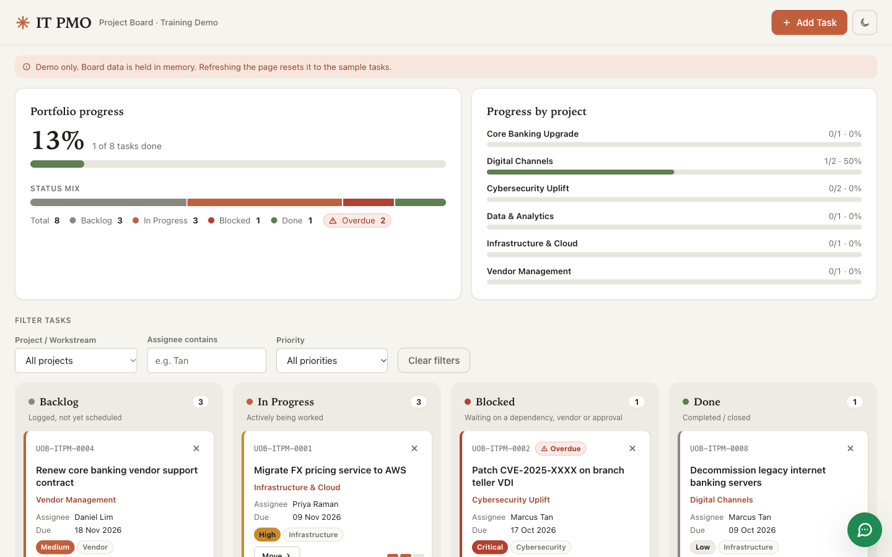

# IT PMO Kanban


[](https://github.com/liuhu6h-del/it-pmo-kanban-v2/actions/workflows/ci.yml)
[](https://liuhu6h-del.github.io/it-pmo-kanban-v2/)

An IT PMO Kanban board, built as a demo and training tool for a fictitious bank. The whole app is one self-contained `index.html` file, with its markup, styles and script inline. There are no frameworks, no dependencies and no build step. It runs straight from the file system or from GitHub Pages.

**v2** has a new warm, Claude-inspired look, a light/dark toggle and visual progress tracking. The original version is still live at [it-pmo-kanban](https://liuhu6h-del.github.io/it-pmo-kanban/).

**Live demo:** https://liuhu6h-del.github.io/it-pmo-kanban-v2/



## Features

- **Progress panel:** overall completion %, a status-mix bar with counts, and a completion bar for each project. The bars animate as tasks move.
- **Stage stepper** on every card, showing how far it is along Backlog → In Progress → Done (Blocked shows in red).
- **Light and dark themes:** the page starts in the operating system's mode, and a button at the top right switches between them. Warm cream and terracotta in light mode, warm charcoal in dark mode.
- **Four columns:** Backlog, In Progress, Blocked and Done, each with a task count.
- **Drag and drop** cards between columns.
- **Move menu** on every card, so a card can be moved with the keyboard or without drag and drop.
- **Filters** by project or workstream, assignee and priority, plus a "Clear filters" button.
- **Add Task** dialog with inline validation. Each task gets a `UOB-ITPM-####` ID.
- **Inline delete** that asks "Delete? Yes / No" on the card itself.
- **Overdue tasks** get a badge, and the progress panel counts them. Seed due dates are set relative to today, so the demo always has some overdue work.
- **Email notification** through [FormSubmit](https://formsubmit.co) when a task is added. The card appears at once, and a warning toast shows if the email fails.
- **Chat widget:** a floating WhatsApp button (a plain `wa.me` link) that speaks a short greeting with the browser's built-in speech synthesis.
- **Security briefing notice:** an in-page dialog shown once, 10 seconds after the page loads.
- Accessible markup: labelled controls, live regions for status messages, and keyboard focus restored after each update.

## How to install

```sh
git clone https://github.com/liuhu6h-del/it-pmo-kanban-v2.git
cd it-pmo-kanban-v2
```

No npm install or build step is needed.

## How to run

- Open `index.html` in a browser: `open index.html` on macOS, or double-click it on Windows.
- Or use the [live demo](https://liuhu6h-del.github.io/it-pmo-kanban-v2/).

Nothing is stored. Refreshing the page resets the board to the sample tasks and the theme to the system setting, on purpose.

## Configuration

New-task emails go to the address in the `FORMSUBMIT_ENDPOINT` constant, in the `CONFIG` block at the top of the `<script>`:

```js
const FORMSUBMIT_ENDPOINT = "https://formsubmit.co/ajax/YOUR_EMAIL@example.com";
```

1. Replace `YOUR_EMAIL@example.com` with your address. In a public repo, this address will be public.
2. Add one task. FormSubmit sends an activation email to that address.
3. Click the activation link. Until you do, FormSubmit answers with `success: "false"` and the board shows a warning toast.

## CI/CD

[`.github/workflows/ci.yml`](.github/workflows/ci.yml) runs on every push to `main`, on pull requests, and on manual dispatch.

- **check** job:
  - a JS syntax check of the inline script
  - a constraint check that fails on `localStorage`, `sessionStorage`, `indexedDB`, `document.cookie`, `confirm(`, `alert(`, `!important`, or any URL other than formsubmit.co and wa.me
  - a secret scan for keys and tokens, and for files such as `.env` or `*.pem`
- **deploy** job (pushes to `main` only): copies only `index.html` into `_site/` and deploys it to GitHub Pages.

## Project constraints

- Vanilla HTML, CSS and JS only. No frameworks, npm, bundler or build step.
- Works from `file://` with no server.
- No external resources: no CDN scripts, web fonts or images. It uses system font stacks and inline SVG icons.
- No persistence of any kind: no localStorage, sessionStorage, IndexedDB or cookies.
- One network call only, to the FormSubmit endpoint. The only other URL is the user-clicked `wa.me` chat link.
- No native `alert()` or `confirm()` dialogs, and no `!important`.
- No real bank branding. The wordmark is the plain text "IT PMO".

See [`CLAUDE.md`](CLAUDE.md) for the full list and the architecture notes.

## Disclaimer

This is a demo and training tool for a **fictitious bank**. It is not affiliated with, endorsed by, or connected to any real bank or any real bank system. The task ID prefix and email subject are part of the demo spec. No real logos or trademarks are used.
